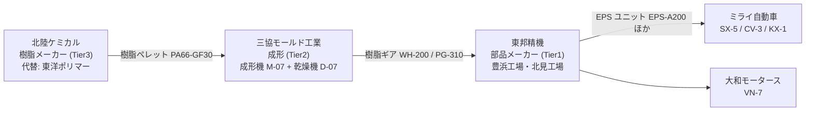
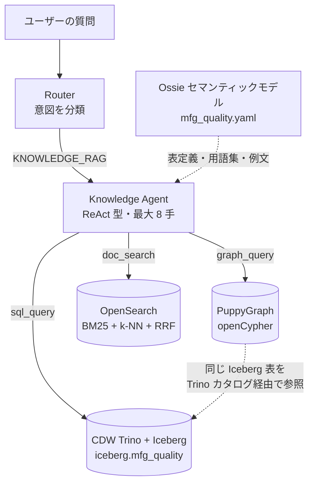
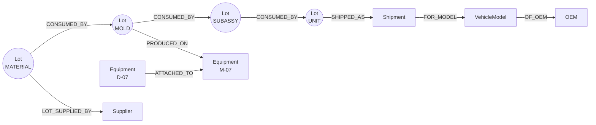

# デモガイド — 製造品質トレーサビリティ（架空データ）

Solomon のデモで「何を見せるか」と「デモデータが何を表しているか」をまとめた資料です。
第 1 部はデモのストーリー（どなたでも）、第 2 部は技術・データの詳細（技術者向け）です。
環境構築・投入・検証の手順は [../SETUP.md](../SETUP.md) を参照してください。

> 登場する会社・製品・ロット・文書はすべて架空です。

---

# 第 1 部 デモストーリー

## 一言で

**市場クレームを起点に、テーブル・グラフ・文書を横断して「原因」と「封じ込め範囲」を自然言語の対話だけで特定する。**

品質保証の現場では、答えが 1 つのシステムにありません。
数量や検査値は基幹 DB に、ロットのつながりは何段にも分かれた系譜データに、決定的な手がかりは現場の作業日報や過去の 8D レポートの自由記述に散らばっています。
Solomon はこの 3 種類のデータを 1 つのエージェントが自律的に使い分けて回答します。

## 登場人物（架空）



| 品番 | 名前 | 説明 |
|---|---|---|
| PA66-GF30 | 樹脂ペレット | ギアの材料。湿気を吸うと強度が落ちる |
| WH-200 | ウォームホイール | EPS（電動パワステ）用の樹脂ギア |
| PG-310 | PW ギア | パワーウィンドウ用の樹脂ギア |
| EPS-A200 | EPS ユニット | SX-5 向けの完成ユニット |

## 何が起きたか（事件の筋書き）

| 日付 | 出来事 | どこに記録されているか |
|---|---|---|
| 2026-05-10 | 樹脂ロット **HC-2605-117** が入荷（CoA 水分率は正常） | 材料ロット表 |
| 2026-05-12 | 成形機 M-07 に付属する乾燥機 **D-07** の露点計が不調になる | 保全記録 MT-2026-0512-D07、設備表（D-07 は M-07 の付属設備） |
| 2026-05-14 | 班長の日報「**7 号機**ドライヤー露点高め。納期優先で乾燥 **2.5h**（通常 4h）で立ち上げ」 | 作業日報 DR-2026-0514-M07（5/12〜5/24 に計 6 件） |
| 2026-05-14〜05-24 | 吸湿したまま M-07 で成形ロット 15 件を生産（117 由来 9 件は 5/14〜5/16、5/18 入荷の **HC-2605-121** 由来 6 件は 5/22・5/24） | ロット表・ロット系譜 |
| 2026-05-19〜06-11 | サブ組立を経て EPS-A200・EPS-A210・PWR-55 のユニット 8 ロットを製造。SX-5 向けは **U-A200-260601〜03**（6/1〜6/3） | ロット系譜・ユニットロット表 |
| 2026-05-26 | D-07 の露点計を交換し、不調が解消 | 保全記録 MT-2026-0526-D07 |
| 2026-06-05〜07-03 | ユニットを OEM 2 社・4 車種へ出荷（一部は在庫に残る） | 出荷表・在庫表 |
| 2026-10-05〜10-14 | SX-5 で「ハンドルを切るとゴトゴト」のクレームが **14 件** | 市場クレーム表 |

この事件には、表だけを見ても気づけない仕掛けがあります。

- **検査はすべて合格。** ただし問題の成形ロットのバックラッシ（歯車のすき間）は規格上限の **92%**。通常のロットは 6 割程度です。
- **過去に同じことが起きていた。** 2024 年に北見工場で 8D レポート **QR-2024-0815** が出ています。内容は「噛み合い時の**打音・コトコト**」「原因: **ペレット吸湿**」。横展開（D7）は未記入のままでした。不良表では「外観その他」として記録されているため、不良コードからも探せません。
- **言葉が一致しない。** 現場の文書は「打音」「コトコト」「ガタ」と書き、クレームは「異音」と呼びます。「異音」でキーワード検索すると、空調やブレーキの点検記録（デコイ文書）ばかりがヒットし、肝心の 8D は出てきません。
- **系譜の深さが品目ごとに違う。** 材料からユニットまで、EPS-A200 は 3 段、PWR-55 は 4 段、EPS-A210 は 5 段です。3 段と決め打ちすると SX-5 しか見つかりません。

## デモで投げる質問

Chat ペインで上から順に聞きます。前の答えを踏まえて次を聞く流れです。

| # | 質問 | 期待される答え（要点） | 主に効くソース |
|---|---|---|---|
| Q1 | SX-5 の異音クレーム 14 件の対象ユニットのロットと製造日は？ | U-A200-260601 / 260602 / 260603（2026-06-01〜03 製造、クレームは 5 / 5 / 4 件） | Table |
| Q2 | そのウォームホイールに使われた樹脂ロットは、他にどの製品・どの車種に入っている？ | 樹脂ロット HC-2605-117。成形ロット 9 件（WH-200×6、PG-310×3）→ EPS-A200・EPS-A210・PWR-55 の 3 製品 → SX-5・CV-3・KX-1・VN-7 の 4 車種、OEM 2 社、出荷 **11,400 台**（SX-5 4,100 / CV-3 2,100 / KX-1 3,300 / VN-7 1,900） | Graph |
| Q3 | 過去に似たような不具合はあった？ | 8D QR-2024-0815（北見工場、打音・コトコト、ペレット吸湿、D7 未記入）。不良表では「外観その他」 | Search |
| Q4 | 検査は全部合格なのに、なぜ不良が出た？ | バックラッシが上限の 92%（通常 60%）で「合格だがギリギリ」。5/14 の日報で乾燥 2.5h への短縮、乾燥機 D-07 の露点計不調 | Table + Search |
| Q5 | 不良条件で作られた可能性がある部品を全部洗い出して | 成形機 M-07、期間 5/12〜5/26（保全記録の不調〜交換）、成形ロット 15 件（材料は HC-2605-117 と HC-2605-121） | Table + Search |
| Q6 | 封じ込め対象ロット・出荷先・台数を根拠付きで確定して | 成形 15 / サブ組立 11 / ユニット 8 ロット。出荷 **12,100 台**（ミライ自動車 SX-5 4,800・CV-3 2,100・KX-1 3,300、大和モータース VN-7 1,900）。在庫 Tier1 1,240 個・Tier2 3,100 個 | 全部 |
| Q7 | 北陸ケミカルから東洋ポリマーに切り替えたら、影響する部品と認可状況は？ | PA66-GF30 を使う成形品 7 点。PPAP 承認済み 4 点（WH-200・WH-210・CL-80・HS-40）、審査中 3 点（PG-310・PG-320・GR-150） | Table |

Q2 と Q6 の台数の違いは、範囲の違いです。Q2 は樹脂ロット 117 に由来する分だけ（11,400 台）、Q6 は不良条件の期間に M-07 で作ったもの全部（117 由来＋121 由来 700 台 = 12,100 台）を数えます。
どちらも正解なので、エージェントがどちらの範囲で答えたかを確かめながら進めてください。

余裕があれば追加で次の 2 つも聞けます（セマンティックモデルに例文として登録済み）。

- 「上記をまとめて 8D の D2〜D4 ドラフトを書いて」
- 「ロット系譜をグラフで見せて」

## 見どころ

1. **言い換えに強い文書検索。** 「異音」でキーワード検索すると 8D は見つかりません。Solomon は意味検索とクエリ拡張で「打音」「コトコト」「ガタ」まで広げて探すので、8D QR-2024-0815 が上位に来ます（目標は上位 3 位以内）。
2. **段数が決まっていないロット系譜をたどる。** 材料からユニットまでの段数は品目によって 3〜5 段あります。SQL で「3 回 JOIN」と決め打ちすると SX-5 の 4,100 台しか見つからず、残り 3 車種 7,300 台を取りこぼします。グラフの可変長トレース（または再帰 SQL）なら最後までたどれます。
3. **「合格だけど危ない」を説明する。** 合否だけ見れば問題なしです。数値の傾向（上限の 92%）と日報の記述（乾燥時間の短縮）を組み合わせて初めて理由が説明できます。
4. **ソースの組み合わせによる差を見せる。** Chat の切り替え（**テーブルのみ / ＋Graph / ＋Search / 全部**）で同じ質問をし、回答の差をその場で比較できます。

## 推奨デモ進行

| 段階 | 操作 | 話すこと |
|---|---|---|
| 1. 素材紹介（3 分） | 左ペインの Tables → Graph → Search タブを順に開く | 表・グラフ・文書という 3 種類のデータがあり、それぞれ別の場所にある |
| 2. 事件の追跡（10 分） | Chat で Q1 → Q5 を順に質問 | エージェントがどのツール（SQL / グラフ / 文書検索）をどの順に使ったかを、思考過程の表示で見せる |
| 3. 比較（3 分） | 「テーブルのみ」で Q3 → 「全部」で Q3 | 表だけでは過去事例にたどり着けない。文書検索が加わると 8D が出てくる |
| 4. 仕上げ（4 分） | Q6・Q7、8D ドラフト、系譜グラフ | 調査結果をそのまま報告書の下書きにできる |

---

# 第 2 部 技術・データ解説

## アーキテクチャ



| 要素 | 役割 | 設定・ファイル |
|---|---|---|
| Router | 質問の意図を判定し、ナレッジ質問を Knowledge Agent へ渡す | `solomon/router/` |
| Knowledge Agent | `sql_query` / `graph_query` / `doc_search` を自律的に組み合わせる | `SOLOMON_RAG_ENGINE=agent`、`solomon/rag/` |
| CDW Trino + Iceberg | 全テーブルの置き場 | `TRINO_SCHEMA=mfg_quality` |
| PuppyGraph | Iceberg 表をそのまま頂点・辺として扱い、ETL なしでグラフ検索する | [../../semantic/graph/schema.yaml](../../semantic/graph/schema.yaml) |
| OpenSearch | 文書本文のキーワード検索とベクトル検索（bge-m3、1024 次元） | `OPENSEARCH_DOCS_INDEX=solomon-mfg-docs` |
| Ossie セマンティックモデル | 表・列の意味、グラフ定義、用語集、検証済み SQL、例文 | [semantic/models/mfg_quality.yaml](semantic/models/mfg_quality.yaml) |

業種の切り替えは `SOLOMON_SEMANTIC_ROOT`、`TRINO_SCHEMA`、`OPENSEARCH_DOCS_INDEX` の 3 つを変えて再起動するだけです。コードは業種に依存しません。

## テーブル一覧

件数は `--scale 1.0`、`--seed 42` で生成したときの実件数です。事件の行は固定で注入し、残りは 2025-01〜2026-10 の通常の生産・出荷・クレームを乱数で埋めています。

| 区分 | テーブル | 内容 | 件数 |
|---|---|---|---|
| マスタ | `suppliers` | サプライヤ（Tier 1/2/3） | 40 |
| | `supplier_alternatives` | 材料ごとの代替サプライヤと PPAP 状態 | 30 |
| | `parts` | 品番マスタ（材料／成形品／サブ組立／ユニット） | 350 |
| | `bom` | 部品構成（親品番・子品番・員数） | 900 |
| | `equipment` | 設備（成形機・乾燥機・組立ライン） | 28 |
| | `vehicle_models` | 車種（SX-5 / CV-3 / KX-1 / VN-7） | 4 |
| | `oem_customers` | OEM（ミライ自動車・大和モータース・背景 OEM） | 3 |
| 製造 | `material_lots` | 材料ロット（入荷日・CoA 水分率） | 300 |
| | `production_runs` | 作業実績（設備・開始/終了・シフト） | 5,099 |
| | `lots` | 材料・成形・サブ組立・ユニットの全ロットを 1 表に統合 | 5,399 |
| | `lot_genealogy` | ロット系譜。1 行 = 親子 1 段の消費関係 | 5,105 |
| | `inspection_results` | 検査結果（測定値・上下限・判定） | 10,549 |
| | `defects` | 工程内不良 | 1,501 |
| 出荷・市場 | `unit_lots` | ユニットロット（製造日・数量） | 1,199 |
| | `shipments` | 出荷（OEM・車種・台数・VIN 範囲） | 2,403 |
| | `inventory` | 在庫（ロット・保管者・Tier・保管場所・数量、2026-10-15 時点） | 41 |
| | `field_claims` | 市場クレーム（車種・VIN・症状コード・症状記述） | 800 |
| 文書 | `doc_index` | 文書メタデータ（種別・日付・工場・設備・品番）。本文は OpenSearch | 3,965 |
| グラフ専用 | `doc_mentions_lot` / `_equipment` / `_part` | 文書がどのロット・設備・品番に言及しているか | 7 / 2,885 / 2,963 |
| | `equipment_links` | 設備の親子関係（D-xx → M-xx） | 12 |

市場クレーム 800 件のうち SX-5 は事件の 14 件だけです。背景のクレームは CV-3・KX-1・VN-7 の別症状（警告灯・ブレーキ鳴き・風切り音など）で、SX-5 のゴトゴトとは混ざりません。

## グラフモデル

PuppyGraph は上の表を次の頂点・辺として見せます。材料からユニットまでの全階層のロットを 1 つの `Lot` 頂点にまとめているので、`CONSUMED_BY` を可変長でたどれます。



Q2 の代表的な Cypher（セマンティックモデルに登録済み）:

```cypher
MATCH (r:Lot {lot_id:$lot_id})-[:CONSUMED_BY*1..6]->(u:Lot {lot_type:'UNIT'})
WITH DISTINCT u
MATCH (u)-[:SHIPPED_AS]->(s:Shipment)-[:FOR_MODEL]->(m:VehicleModel)
RETURN u.part_no AS product, m.model_name AS model,
       count(DISTINCT u) AS unit_lots, sum(s.qty) AS vehicles
```

同じユニットに複数の経路で届くことがあるので、`WITH DISTINCT u` で重複を除いてから台数を合計します。
在庫（`inventory`）はグラフには載せていないので、SQL で引きます。

## ロット ID の読み方

| 例 | 階層 | 読み方 |
|---|---|---|
| `HC-2605-117` | 材料 | 2026 年 5 月入荷の 117 番の樹脂ロット |
| `ML-2605-117-WH200-01` | 成形 | 材料ロット 2605-117 から作った WH-200 の 1 番目の成形ロット |
| `SA-A200-260528-01` | サブ組立 | EPS-A200 向けサブ組立、2026-05-28 製造の 1 番目 |
| `SA-A210-1-260520-01` | サブ組立 | EPS-A210 向けサブ組立の第 1 工程、2026-05-20 製造の 1 番目 |
| `U-A200-260601` | ユニット | EPS-A200 ユニット、2026-06-01 製造 |
| `SHP-2600001` / `INV-260001` | 出荷 / 在庫 | 出荷番号・在庫番号 |
| `SX5-0100001` | VIN | SX-5 の車台番号。出荷表の VIN 範囲とクレームの VIN が対応する |

事件の系譜（実データ。矢印は「投入 → 生成」）:

```
HC-2605-117 ─┬─ ML-2605-117-WH200-01〜03 ── SA-A200-2605(28〜30)-01 ─────────────────────────── U-A200-260601〜03 → SX-5   （3 段）
             ├─ ML-2605-117-PG310-01〜03 ── SA-P55-1-2605(19,20)-01 ── SA-P55-2-260526-01 ───── U-P55-260610 / 11 → VN-7  （4 段）
             └─ ML-2605-117-WH200-04〜06 ── SA-A210-1-260520-01 ── SA-A210-2 ── SA-A210-3 ── U-A210-260608 / 09 → CV-3, KX-1（5 段）
HC-2605-121 ─┬─ ML-2605-121-WH200-01, 02 ── SA-A200-260603-01 ──────────────────────────────── U-A200-260605 → SX-5（700 台）
             ├─ ML-2605-121-WH200-03, 04 ── SA-A200-260604-01（Tier1 在庫 600）
             └─ ML-2605-121-WH200-05, 06（Tier2 在庫 1,600 + 1,500）
```

U-P55-260611 は出荷されず、Tier1 の完成品在庫（640 個）として残っています。

## 仕込まれた「隠し事実」

scenario.yaml の `hidden_facts` は、エージェントが見つけるべき事実です。

| ID | 内容 | 仕込み先 |
|---|---|---|
| H1 | 樹脂ロット HC-2605-117 → 成形ロット 9 件 → 3 製品・4 車種・OEM 2 社、出荷 11,400 台に波及 | `material_lots`、`lot_genealogy`、`shipments` |
| H2 | 2024 年の類似 8D（北見工場、打音・コトコト、ペレット吸湿、D7 未記入）。不良表のコードは「外観その他」 | 文書 QR-2024-0815、DR-2025-0320-北見、`defects`（DEF-2024-0815-01）、北見の成形機 K-03 |
| H3 | 5/14 の日報で乾燥を 2.5h に短縮。設備名の表記ゆれ（7 号機 / M07 / 成形 No.7 / 7 番機） | 文書 DR-2026-0512〜0524-M07（6 件） |
| H4 | 不良条件は M-07、5/12〜5/26、成形ロット 15 件 | `lots`（equipment_id = M-07）、`equipment`、保全記録 MT-2026-0512-D07 / MT-2026-0526-D07 |
| H5 | バックラッシは上限比 92%（通常の成形ロットは約 60%）だが判定はすべて OK | `inspection_results` |
| H6 | 「異音」「振動」を含むデコイ文書 400 件（空調・ブレーキ・電気ノイズの話） | OpenSearch 文書 |

## 文書コーパス

| 種別 | 件数 | 内訳 |
|---|---|---|
| 作業日報 | 1,983 | 通常 1,800 + デコイ 176 + 仕込み 7 |
| 設備保全記録 | 826 | 通常 600 + デコイ 224 + 仕込み 2 |
| OEM クレーム文 | 800 | 市場クレームの文面 |
| 不具合報告書 | 250 | 工程内不具合 |
| 4M 変更届 | 50 | 変更・PPAP |
| 8D レポート | 41 | 通常 40 + 仕込み 1 |
| FMEA | 15 | 故障モード影響解析 |

仕込み文書は 10 件です。

| 文書 | 内容 |
|---|---|
| QR-2024-0815 | 2024 年の北見工場の 8D（打音・コトコト、ペレット吸湿、D7 未記入） |
| DR-2025-0320-北見 | 北見の日報（2025-03）。立ち上げ品でコトコト音、ペレット水分が高めで乾燥やり直し（8D 後も同じ現象が出ていた） |
| DR-2026-0512 / 0514 / 0515 / 0516 / 0522 / 0524-M07 | M-07 の日報。露点高め・乾燥 2.5h など。設備名は表記ゆれあり |
| MT-2026-0512-D07 / MT-2026-0526-D07 | D-07 の露点計不調と交換（不良条件の期間の根拠） |

仕込み文書にはわざと「異音」という語を入れていません。代わりに打音・コトコト・ガタなど現場の言葉で書いてあります（生成時に自動チェック）。
一方、デコイ文書 400 件には「異音」が入っているため、キーワード検索だけでは本命の文書が埋もれます。scenario.yaml の `search_checks` で「意味検索＋拡張では 8D が上位 3 位以内、キーワード検索では上位 20 位にも入らない」ことを検証できます。
通常の文書には事件の手掛かり語（ゴトゴト・ガタ・樹脂ギア・2.5h・露点高め）を使わず、不良条件の期間の前後には M-07 / D-07 の記録を置いていません。

## データの作り方

- **再現可能。** `--seed 42` で固定。同じ seed なら毎回同じ Parquet（ハッシュ一致）になります。
- **事件部分は固定注入、背景は乱数。** 事件のロット・系譜・出荷・在庫・クレーム・文書は ID 固定で [generator/inject.py](generator/inject.py) が入れ、背景は [generator/simulate.py](generator/simulate.py) と [generator/documents.py](generator/documents.py) が乱数で埋めます。背景は事件の答えを変えないように作っています（M-07 の不良条件の期間には背景ロットを作らない、SX-5 の背景クレームは作らない、背景のバックラッシは上限の 5〜7 割など）。
- **自己チェック付き。** 生成後に Q1〜Q7 の答えがデータから出ることを、エージェントが書くはずの SQL と同じ形で確かめ、`output/manifest.json` の `checks.ok` に結果を残します。主なチェック項目は次のとおりです。
  - Q1: クレーム 14 件・ユニット 3 ロット・製造日、クレームの VIN が出荷の VIN 範囲内にあること
  - Q2: 117 由来の成形 9 ロット・3 製品・4 車種・11,400 台・OEM 2 社。固定 3 段 JOIN では SX-5 しか出ないこと
  - Q3〜Q5: 8D の不良コード、バックラッシ 92% / 60%、検査が全件 OK、M-07 の 15 ロットと材料 2 ロット
  - Q6: サブ組立 11・ユニット 8・車種別出荷台数・Tier 別在庫
  - Q7: 対象 7 部品・承認済み 4・審査中 3

```bash
PYTHONPATH=. python -m demo.mfg_quality.generator --seed 42 --scale 1.0 --docs template
```

投入（`demo.loader`）と検証（`demo.validate`）は [../SETUP.md](../SETUP.md) の「d. データ準備」を参照してください。ローカル検証（`--level local`）は 2026-11-05 時点で 55 項目すべて合格しています。

## 発表者向けの注意

- **Q1〜Q7 はすべてデータから答えが出ます。** 期待値は scenario.yaml の `expected_answers` / `containment` / `q7_ppap` にあります。
- **Q2 と Q6 の台数は 2 通り。** 117 由来だけなら 11,400 台、不良条件の期間全体なら 12,100 台です。どちらも正解として扱ってください。
- **文書本文は短い定型文です。** `--docs llm` は未実装で、template と同じ出力になります。
- **投入前に生成し直してください。** 生成器を更新した後は、上のコマンドで `output/` を作り直してから投入します。

---

## 関連ドキュメント

- [README.md](README.md) — 生成器の使い方
- [scenario.yaml](scenario.yaml) — 正解データ・質問・検索チェック
- [../SETUP.md](../SETUP.md) — 環境構築・投入・検証・リハーサル
- [../loader/README.md](../loader/README.md) / [../validate/README.md](../validate/README.md)
